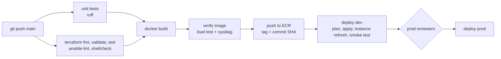
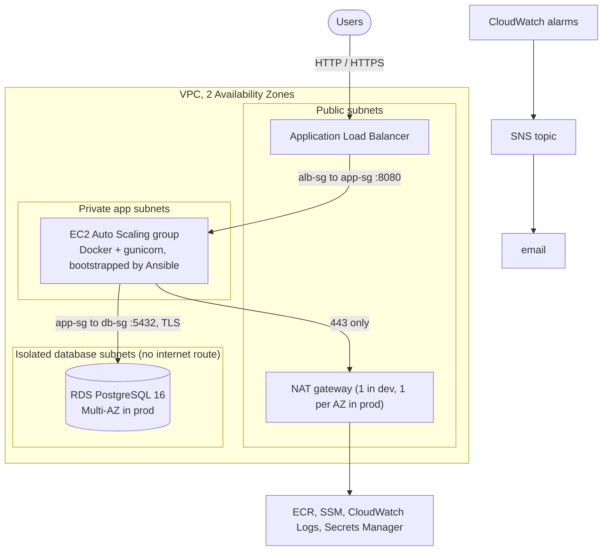

# aws-cicd-pipeline

An end-to-end CI/CD pipeline that takes a web service from `git push` to a multi-tier AWS environment. It covers infrastructure as code, image verification, a gated rollout to dev then prod, and alerting.

- **Terraform**: a VPC across two Availability Zones, with an internet-facing ALB, EC2 in an Auto Scaling group, RDS PostgreSQL, NAT gateways and layered security groups. One root module deploys either **dev** or **prod**; only a tfvars file differs.
- **GitHub Actions** runs on every push to `main`: tests, IaC checks, Docker build, performance and systems checks, push to Amazon ECR, then a Terraform deploy with a rolling instance refresh and a smoke test. **CloudWatch alarms** notify through **SNS**.
- A **Jenkinsfile** runs the same pipeline on Jenkins, and an **Ansible** playbook bootstraps every EC2 host the same way.
- **Pre-deploy gates** catch regressions before an image is pushed:
  - a load test with latency and error budgets;
  - `/proc`-based diagnostics of processes, sockets and resource limits, which flag fd leaks, CLOSE_WAIT build-up, worker crashes and too-low ulimits.



## Architecture



Traffic only moves one tier inward, and each security group admits only the security group in front of it, never a CIDR range. Nothing is reachable over SSH; operators use SSM Session Manager.

| Tier | What's there | Guard rails |
|---|---|---|
| Public | ALB, NAT gateways | ALB drops invalid headers; optional HTTPS with a TLS 1.2/1.3 policy and HTTP->HTTPS redirect |
| App | EC2 Auto Scaling group (Amazon Linux 2023) | IMDSv2 only, encrypted gp3, no public IPs, egress limited to 443 and to the database security group |
| Data | RDS PostgreSQL | Private, encrypted, `rds.force_ssl=1`, password generated and rotated by RDS in Secrets Manager |

## Where each piece lives

| Capability | Files |
|---|---|
| Multi-tier AWS environment | `terraform/modules/{network,security,alb,compute,database,monitoring}` |
| Same code for dev and prod | `terraform/live` (one root module) + `terraform/live/env/{dev,prod}.tfvars` |
| State, ECR, CI identity | `terraform/bootstrap` (S3 state with native locking, ECR, GitHub OIDC role) |
| GitHub Actions pipeline | `.github/workflows/pipeline.yml`, `.github/workflows/deploy.yml` |
| Jenkins pipeline | `Jenkinsfile` (calls the same `make` targets) |
| Host bootstrapping | `ansible/` (roles `base`, `docker`, `app`), run from EC2 user data |
| CloudWatch alarms + SNS | `terraform/modules/monitoring` |
| Performance checks | `scripts/perf/loadtest.py` |
| Systems diagnostics | `scripts/diagnostics/sysdiag.py` |
| Deploy / verify / smoke scripts | `scripts/ci/*.sh` |
| Application | `app/` (Flask + gunicorn, Postgres or in-memory storage) |

```
.
├── app/                     Flask service, Dockerfile, gunicorn config, tests
├── ansible/                 site.yml + roles: base (sysctl, limits), docker, app (systemd unit)
├── scripts/
│   ├── ci/                  tf.sh, deploy.sh, smoke_test.sh, verify_image.sh, push_image.sh
│   ├── diagnostics/         sysdiag.py  (stdlib only; also shipped inside the image)
│   ├── perf/                loadtest.py (stdlib only)
│   └── tests/               tests for both tools, including a fake /proc tree
├── terraform/
│   ├── bootstrap/           one-time: state bucket, ECR repo, GitHub OIDC deploy role
│   ├── live/                root module for every environment + env/*.tfvars + plan tests
│   └── modules/             network, security, alb, compute, database, monitoring
├── .github/workflows/       pipeline.yml (orchestration), deploy.yml (reusable deploy job)
├── Jenkinsfile
├── Makefile                 the single entry point both CI systems use
└── docker-compose.yml       app + Postgres locally
```

## The pipeline, stage by stage

| Stage | Runs on | What it does | Fails the build when |
|---|---|---|---|
| **unit tests** | every push and PR | `ruff` format and lint checks, then `pytest` over the app and both tools, with coverage and JUnit reports | any test or lint failure |
| **IaC checks** | every push and PR | `terraform fmt -check` and `validate`; `terraform test` for the network module; a full-stack **plan test for dev and prod** against a mocked AWS provider; `ansible-lint` on the production profile; `shellcheck` | formatting drift, invalid config, or a plan that breaks the dev/prod contract (e.g. prod losing Multi-AZ) |
| **build + verify** | every push and PR | Builds the image, runs it with production ulimits and worker count, takes a diagnostics snapshot, runs 3,000 requests against budgets, then diagnoses again against the snapshot | p95 > 150 ms, p99 > 400 ms, any errors, fd growth > 25, RSS growth > 50%, a worker replaced mid-test, too-low `nofile`/`nproc`, CLOSE_WAIT pile-up, accept-queue backlog |
| **push** | `main` only | Pushes `aws-cicd-pipeline-app:<commit SHA>` to ECR over OIDC (no stored AWS keys). Tags are immutable. | |
| **deploy dev** | `main` only | Runs `terraform plan`, then `apply`, then waits for the rolling instance refresh. The smoke test then needs 10 consecutive responses from the new version, `/ready` = 200, and a write + read through Postgres. | the tag isn't in ECR (caught at plan time), the refresh fails (it auto-rolls back), or the smoke test fails |
| **deploy prod** | after dev succeeds | Same job as dev, behind the `prod` environment's required reviewers | same as dev |

**Rollback** means re-running the workflow manually (*Run workflow*) with `image_tag` set to an earlier commit SHA. The build is skipped and that image is redeployed with the current infrastructure code. ECR keeps the last 30 images.

## Dev vs prod

Both environments run the same modules. The only differences are in `terraform/live/env/*.tfvars`:

| | dev | prod |
|---|---|---|
| VPC | 10.10.0.0/16 | 10.20.0.0/16 |
| NAT gateways | 1 shared | 1 per AZ |
| App instances | t3.micro, 1 to 2 | t3.small, 2 to 6 |
| Gunicorn workers per instance | 2 | 4 |
| RDS | db.t4g.micro, single-AZ, 1-day backups | db.t4g.small, **Multi-AZ**, 7-day backups, deletion protection, final snapshot |
| ALB deletion protection | off | on |
| Log retention | 7 days | 30 days |

`terraform/live/tests/plan.tftest.hcl` plans the full stack with each committed tfvars file and asserts these differences, so a tfvars edit that drops prod redundancy fails CI.

## Setup

**Prerequisites:** an AWS account, Terraform >= 1.10, AWS CLI v2, Docker, Python 3.12, and a copy of this repo on GitHub.

1. **Bootstrap (once per account).** This creates the state bucket, the ECR repository and the role GitHub Actions assumes:
   ```bash
   cd terraform/bootstrap
   terraform init
   terraform apply            # add -var create_github_oidc_provider=false if the account already has one
   terraform output
   ```
   If your GitHub repository isn't `SrujanRudrapati/aws-cicd-pipeline`, pass `-var github_repository=<owner>/<repo>`. The role only trusts that repository's `main` branch and its GitHub Environments.

2. **Repository variables** (*Settings -> Secrets and variables -> Actions -> Variables*). All of these are identifiers, not secrets:

   | Variable | Value |
   |---|---|
   | `AWS_REGION` | `aws_region` output |
   | `AWS_ROLE_ARN` | `github_actions_role_arn` output |
   | `TF_STATE_BUCKET` | `state_bucket` output |
   | `ECR_REPOSITORY` | `ecr_repository_name` output |
   | `ALERT_EMAIL` | *(optional)* address for alarm emails |

3. **Environments** (*Settings -> Environments*): create `dev` and `prod`. On `prod`, add required reviewers and restrict deployment branches to `main`.

   Until `AWS_ROLE_ARN` is set, the pipeline runs in CI-only mode: tests, IaC checks and image verification run, and the push and deploy stages are skipped.

4. **Push to `main`.** The first deploy of an environment takes about 15-20 minutes, mostly RDS creation. After that, a release is mainly the instance refresh, typically 5-10 minutes. If you set `ALERT_EMAIL`, confirm the SNS subscription email.

5. Run `terraform init` in `terraform/bootstrap` and `terraform/live`, then commit the generated `.terraform.lock.hcl` files so every run uses the same provider builds.

For **Jenkins**, see the header of the `Jenkinsfile`. You need a multibranch job, a global `TF_STATE_BUCKET` variable and an `aws-deploy` credential.

### From a laptop

```bash
make install test                       # unit tests
make run                                # app on :8080 with in-memory storage
make up / make down                     # app + Postgres via Docker Compose
make image verify                       # build, load test, diagnose (needs Docker)
make tf-validate                        # all offline IaC checks, no AWS needed

eval "$(make bootstrap-env)"            # exports AWS_REGION, TF_STATE_BUCKET, ECR_REPOSITORY
make image verify push deploy ENV=dev   # the whole pipeline, by hand
```

## Performance and systems checks

Both tools use only the Python standard library, so they run in CI, inside the container, and directly on hosts.

**`scripts/perf/loadtest.py`** is a threaded HTTP/1.1 keep-alive load generator. It reports p50/p90/p95/p99 latency, throughput and error rate, and enforces absolute budgets. Given `--baseline`, it also enforces relative ones: p95/p99 may not regress more than 50% against a previous `perf.json`.

**`scripts/diagnostics/sysdiag.py`** reads Linux `/proc` directly:

| Check | Source | Catches |
|---|---|---|
| `limits.nofile`, `limits.nproc` | `/proc/<pid>/limits` of the *server* process | a container or unit started with the default 1024-fd limit |
| `process.workers`, `process.zombies` | `/proc/<pid>/status`, parent/child tree | workers that failed to boot, children nobody reaps |
| `process.rss`, `process.fds` | `VmRSS`, `/proc/<pid>/fd` | memory bloat, fd usage close to the limit |
| `sockets.listen`, `sockets.accept_queue` | `/proc/net/tcp{,6}` | port not bound, backlog filling faster than workers accept |
| `sockets.close_wait` | `/proc/net/tcp{,6}` | connections the peer closed but the app never did (fd leak) |
| `baseline.*` | compared with an earlier snapshot | fd growth or RSS growth under load, workers replaced mid-test (crash, timeout, OOM) |

Example from a verify run:

```text
loadtest  GET http://127.0.0.1:18080/api/info  requests=3000 concurrency=16
  throughput  1924.2 req/s over 1.559 s
  latency ms  min 0.42  p50 7.43  p90 11.6  p95 13.34  p99 16.14  max 21.75
p95 latency        PASS   13.34 ms <= 150 ms
error rate         PASS   0.00% <= 0.00% (0 of 3000)

CHECK                  RESULT DETAIL
process.workers        PASS   2 workers under master pid 126 (expected 2)
sockets.close_wait     PASS   0 in CLOSE_WAIT (budget 10)
baseline.restarts      PASS   no worker restarts
baseline.fd_growth     PASS   30 -> 30 open fds (+0, budget +25)
baseline.rss_growth    PASS   85.4 -> 86.4 MiB (+1.2%, budget +50%)
RESULT: PASS
```

The same diagnostics ship inside the image, and Ansible installs a wrapper on every host, so the checks that gated the deploy can be re-run against production:

```bash
aws ssm start-session --target <instance-id>
sudo app-diag              # human-readable report
sudo app-diag --json -     # machine-readable
```

## Operations

| Task | How |
|---|---|
| Roll back | *Actions -> pipeline -> Run workflow* with `image_tag` = an earlier commit SHA |
| Open a shell | `aws ssm start-session --target <instance-id>` (no SSH, no key pairs) |
| App logs | CloudWatch Logs group `/aws-cicd-pipeline-<env>/app`, one stream per host |
| Bootstrap log | `/var/log/app-bootstrap.log` on the instance |
| Re-apply host config | `cd /opt/bootstrap/ansible && sudo ansible-playbook site.yml -i localhost, -c local -e @/etc/app-bootstrap/vars.json` |
| Dashboard | `terraform output dashboard_url` (for the matching environment) |
| Alarms | 5xx from targets and from the ALB, p95 latency, unhealthy hosts, **no healthy hosts**, app CPU, RDS CPU, storage and memory; all notify on ALARM and OK |

## Cost and teardown

Approximate us-east-1 on-demand prices, before free tier:

| | Main costs | Rough total |
|---|---|---|
| dev | NAT gateway (~$33/mo), ALB (~$16/mo), t3.micro, db.t4g.micro, public IPv4 addresses | **~$2.50/day** |
| prod | 2 NAT gateways, ALB, 2x t3.small, Multi-AZ db.t4g.small | **~$6/day** |

For a portfolio, deploy dev, take screenshots of the pipeline run, the dashboard and the app, then tear it down:

```bash
eval "$(make bootstrap-env)"
make destroy ENV=dev
```

Prod is protected on purpose. To remove it:
1. Set `db_deletion_protection = false`, `alb_deletion_protection = false` and `db_skip_final_snapshot = true` in `prod.tfvars`.
2. Deploy once so the change applies.
3. Run `make destroy ENV=prod`.

Remove the bootstrap stack last, with `terraform apply -var force_destroy=true` and then `terraform destroy`.

## Design decisions

- **One root module, per-environment tfvars and state.** Environments can't drift in code. The plan tests fail CI if a tfvars change breaks what prod must have.
- **A release is a launch template change.** The image tag goes into user data, so a new tag means a new launch template version. The Auto Scaling group then runs a rolling instance refresh:
  - min 100% / max 200% healthy launches replacements before draining old instances;
  - auto-rollback restores the previous version if new instances never get healthy.
- **Plan-time release guard.** `data "aws_ecr_image"` fails the plan if the tag was never pushed, instead of rolling out instances that can't pull their image.
- **Immutable, SHA-tagged images.** The tag running in an environment is always the exact commit that passed CI, and rollbacks are just a redeploy of an older tag.
- **No long-lived AWS keys in GitHub.** Workflows use GitHub OIDC. The deploy role only trusts `main` and GitHub Environments, and its IAM rights are limited to `aws-cicd-pipeline-<env>-*` roles, so it can't grant itself more access.
- **No SSH.** No key pairs and no port 22; SSM Session Manager instead, which is also logged.
- **IMDSv2 with hop limit 2.** Tokens are required, and the containerized app, one extra network hop away, can still reach instance credentials for Secrets Manager.
- **Security groups reference security groups.** ALB -> app -> database is enforced by identity, not by subnet ranges. The database security group has no egress rules, and the VPC's default security group is emptied.
- **Isolated database subnets.** The database route table has no default route at all, not even through NAT.
- **RDS manages the database password.** It never appears in Terraform state, tfvars, CI logs or instance disks. The app reads it from Secrets Manager at startup.
- **Liveness vs readiness.** The ALB checks `/health` (process alive) rather than `/ready` (database reachable). A database blip should raise an alarm, not make the ALB pull every instance at once.
- **gunicorn keep-alive (75s) > ALB idle timeout (60s).** The ALB always closes idle connections first, which avoids sporadic 502s from reusing a connection the app just closed.
- **Versioned Ansible bundle.** The playbook is zipped into a versioned S3 bucket, and user data pins the object *version*. Every launch template version, including one restored by a rollback, boots with the host configuration it shipped with.
- **Leak checks run before push.** Unit tests don't catch fd leaks, zombie workers or a 1024-fd ulimit, but a short load test plus `/proc` diagnostics does, before the image reaches ECR.
- **One Makefile for both CI systems.** GitHub Actions and Jenkins differ only in orchestration; every build, check and deploy step is shared.
- **S3 gateway endpoint.** Free, and it keeps ECR layer downloads and the Ansible bundle off the metered NAT gateway.
- **The SNS topic isn't KMS-encrypted.** CloudWatch alarms can't publish to a topic encrypted with the AWS-managed key. Encrypting it needs a customer-managed key that grants CloudWatch access; alert payloads here carry no sensitive data.

## Possible next steps

- HTTPS by default: an ACM certificate and a Route 53 record (the ALB module already supports `certificate_arn`).
- AWS WAF on the ALB; `sslmode=verify-full` with the RDS CA bundle.
- Separate AWS accounts per environment (AWS Organizations) and a permissions boundary on the deploy role.
- VPC interface endpoints for ECR, SSM and Logs to cut NAT traffic further.
- Blue/green target groups, or a canary step with alarm-based rollback during the instance refresh.
- `trivy`, `checkov` or `tfsec` in the IaC stage; ECR scan results as a gate.

## License

MIT
